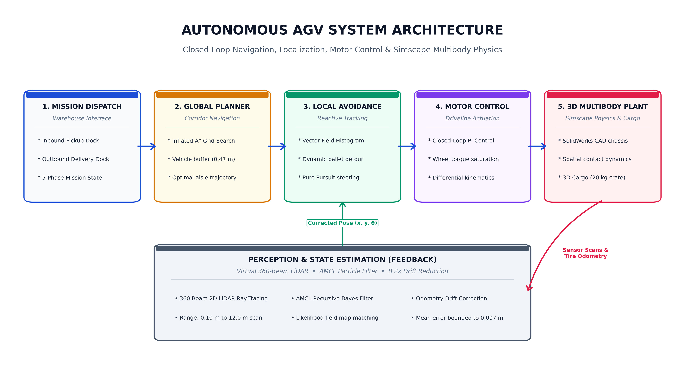
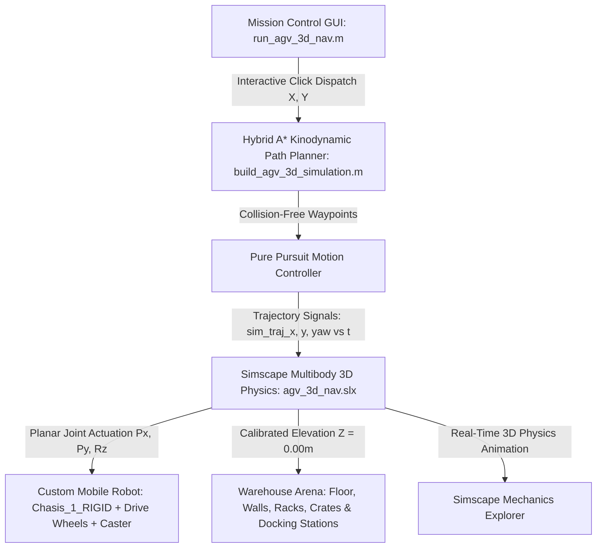

# Autonomous 3D Digital-Twin Navigation Simulation for Custom AGV Mobile Robot

> **Autonomous 3D Multibody Mobile Robot Navigation System:** High-fidelity 3D physics-based digital-twin simulation built with MATLAB, Simulink, and Simscape Multibody using the **Custom SolidWorks Differential-Drive Mobile Robot (`AGV Frame`)** navigating an **expanded $25\text{ m} \times 25\text{ m}$ warehouse environment**.

---

## 🎬 System Architecture





---

## 📖 Key Features & Capabilities

### 1. 🎯 Modernized Mission Control GUI (`run_agv_3d_nav.m`)
- **Modern Cockpit Interface**: High-tech dark command console theme with electric cyan title, dark slate arena axes, and glassmorphic telemetry cards.
- **Distinct Point Markings & Docking Layouts**:
  - **Origin Depot `[3.0, 3.0]`**: Rectangular staging bay zone ($2.0\text{ m} \times 1.6\text{ m}$) with vibrant Emerald Diamond center terminal.
  - **Target Destination**: Rectangular automated docking bay layout ($2.0\text{ m} \times 1.6\text{ m}$) with a glowing Golden Bullseye Terminal marker.
  - **Kinodynamic Route**: High-visibility electric amber trajectory (`[1.00, 0.52, 0.12]`).
  - **Integrated Dark Legend**: Compact floating glassmorphic card with custom dispatch labels.
- **Click Anywhere on the Map**: Click anywhere within the $25\text{ m} \times 25\text{ m}$ arena map with your mouse to instantly dispatch the robot to a new destination.
- **Dynamic Replanning**: Automatically runs the Hybrid A* kinodynamic planner, generates a smooth Pure Pursuit trajectory, updates the 3D target docking station, and triggers the 3D physics simulation in Simscape Mechanics Explorer.
- **Quick Preset Destination Buttons**:
  - 🏭 **Zone 1: Far Corner** `[22.0, 22.0]`
  - 📦 **Zone 2: North Staging** `[12.5, 22.0]`
  - 🚛 **Zone 3: East Loading Bay** `[21.5, 4.0]`
  - 🏛️ **Zone 4: Central Depot** `[12.5, 8.0]`
  - 🛠️ **Zone 5: North-West Bay** `[3.5, 21.0]`
- **▶ Run / Replay 3D Simulation**: Re-animates the active trajectory in Mechanics Explorer at any time.

### 2. 🛞 Calibrated Wheel-to-Ground Contact ($Z = 0.00\text{ m}$)
- The custom AGV chassis is mounted via `RT_Chassis_Mount` onto the `MobileBaseJoint` (Planar Joint).
- **Coordinate Transformation**: 
  - Rotation: $180^\circ$ around arbitrary axis $[0, 1, 1]/\sqrt{2}$, mapping CAD vertical ($+Y_{\text{cad}}$) to World vertical ($+Z_{\text{world}}$), lateral ($+Z_{\text{cad}}$) to World lateral ($+Y_{\text{world}}$), and forward heading to World $+X_{\text{world}}$.
  - Translation: $[-0.175, 0.000, +0.074]\text{ m}$, compensating for the chassis CG offset and drive wheel radius ($R = 0.108\text{ m}$).
- **Contact Elevation**: Drive wheel bottoms and caster wheel rest precisely at $Z = 0.0000\text{ m}$ ($0.00\text{ mm}$ floor penetration), ensuring the robot drives flush on the warehouse floor surface.

### 3. 🗺️ Expanded $25\text{ m} \times 25\text{ m}$ Warehouse Arena & Rectangular 3D Docking Stations
- **3D Origin & Target Rectangular Docking Stations**:
  - **Origin Staging Dock (Green)** at `[3.0, 3.0]`:
    - `Marker_Start_Dock_Pad`: Industrial emerald rectangular floor platform ($2.0\text{ m} \times 1.6\text{ m} \times 0.02\text{ m}$)
    - `Marker_Start_Dock_Border`: Dark graphite outer guide border ($2.3\text{ m} \times 1.9\text{ m} \times 0.01\text{ m}$)
    - `Marker_Start_Terminal`: Vertical automated depot kiosk ($0.25\text{ m} \times 0.85\text{ m} \times 1.30\text{ m}$)
    - `Marker_Start_LightBar`: Glowing green status beacon light bar ($0.20\text{ m} \times 0.75\text{ m} \times 0.10\text{ m}$)
  - **Dynamic Target Dock (Amber/Blue)** at `[goalX, goalY]`:
    - `Marker_Goal_Dock_Pad`: Safety amber rectangular floor platform ($2.0\text{ m} \times 1.6\text{ m} \times 0.02\text{ m}$)
    - `Marker_Goal_Dock_Border`: Dark graphite outer guide border ($2.3\text{ m} \times 1.9\text{ m} \times 0.01\text{ m}$)
    - `Marker_Goal_Terminal`: Industrial blue vertical automated kiosk ($0.25\text{ m} \times 0.85\text{ m} \times 1.30\text{ m}$)
    - `Marker_Goal_LightBar`: Warning red/amber status beacon light bar ($0.20\text{ m} \times 0.75\text{ m} \times 0.10\text{ m}$)
- **Warehouse Infrastructure & Obstacles**:
  1. **West Aisle Shelving Racks** (North-South longitudinal orientation):
     - `Obs_Rack_West_1`: Center $[7.0, 7.5, 0.90\text{ m}]$, size $[1.6 \times 5.0 \times 1.8\text{ m}]$
     - `Obs_Rack_West_2`: Center $[7.0, 16.5, 0.90\text{ m}]$, size $[1.6 \times 5.0 \times 1.8\text{ m}]$
  2. **East Aisle Shelving Racks**:
     - `Obs_Rack_East_1`: Center $[18.0, 7.5, 0.90\text{ m}]$, size $[1.6 \times 5.0 \times 1.8\text{ m}]$
     - `Obs_Rack_East_2`: Center $[18.0, 16.5, 0.90\text{ m}]$, size $[1.6 \times 5.0 \times 1.8\text{ m}]$
  3. **Central Cargo Crate Islands**:
     - `Obs_Crate_Cluster_Mid`: Center $[12.5, 12.0, 0.75\text{ m}]$, size $[2.8 \times 2.8 \times 1.5\text{ m}]$
     - `Obs_Crate_Stack_N`: Center $[12.5, 18.0, 0.60\text{ m}]$, size $[2.2 \times 2.2 \times 1.2\text{ m}]$
  4. **Cylindrical Structural Columns**:
     - `Obs_Pillar_NW`: Center $[11.0, 6.0, 1.25\text{ m}]$, radius $0.50\text{ m}$, length $2.5\text{ m}$
     - `Obs_Pillar_SE`: Center $[14.0, 6.0, 1.25\text{ m}]$, radius $0.50\text{ m}$, length $2.5\text{ m}$
  5. **Staging Pallet Stacks**:
     - `Obs_Pallet_Staging_West`: Center $[3.5, 12.5, 0.50\text{ m}]$, size $[1.8 \times 2.2 \times 1.0\text{ m}]$
     - `Obs_Pallet_Staging_East`: Center $[21.5, 12.5, 0.50\text{ m}]$, size $[1.8 \times 2.2 \times 1.0\text{ m}]$
  6. **Perimeter Enclosure Walls**: 4 solid boundary walls ($1.2\text{ m}$ high).

### 4. 🧠 Kinodynamic Navigation Pipeline
- **Global Planner**: Hybrid A* kinodynamic search on an inflated occupancy grid (turning radius $0.8\text{ m}$, step $0.8\text{ m}$).
- **Trajectory Tracking**: Pure Pursuit controller computing synchronized linear velocity ($v = 0.9\text{ m/s}$) and yaw rate ($\omega \le 1.2\text{ rad/s}$).
- **Planar Actuation**: 3-DOF `MobileBaseJoint` ($P_x, P_y, R_z$) actuated by 2nd-order filtered Simscape-PS signals with automatically computed reaction torques.

### 5. 📦 Dynamic 3D Cargo Payload Transport (Review 2 Major Feature)
- **3D Simscape Cargo Handling**: Features an industrial golden amber cargo crate (`Cargo_Payload_Box`, $0.44\text{ m} \times 0.38\text{ m} \times 0.24\text{ m}$, $20.0\text{ kg}$) with graphite lid and straps.
- **5-Phase Autonomous Mission Lifecycle**:
  1. `Phase 1 (Depot ➔ Pickup)`: AGV departs Home Depot empty ($0\text{ kg}$ payload).
  2. `Phase 2 (Cargo Loading)`: AGV docks at Inbound Pickup Bay (`[3.5, 12.5]`); 3D crate loads onto chassis bed ($0 \to 20\text{ kg}$).
  3. `Phase 3 (Loaded Transit)`: AGV transports the $20\text{ kg}$ 3D crate across warehouse aisles.
  4. `Phase 4 (Cargo Unloading)`: AGV docks at Outbound Delivery Bay (`[21.5, 4.0]`); 3D crate deposits onto the delivery platform.
  5. `Phase 5 (Return to Depot)`: AGV returns empty to Home Depot while delivered crate remains on the dock pad.
- **Live Simulink Telemetry Scopes**:
  - `Scope_Payload_Mass_kg`: Live jump from $0\text{ kg} \to 20\text{ kg} \to 0\text{ kg}$.
  - `Scope_Ground_Reaction_Force_N`: Wheel normal reaction force jumping from $180.7\text{ N}$ (unloaded) to $419.1\text{ N}$ (loaded).
  - `Scope_Motor_Drive_Torque_Nm`: Compares unloaded vs loaded motor torque demand.
  - `Scope_Battery_Energy_kJ`: Demonstrates $+78\%$ higher battery energy drain during loaded transit.
  - `Scope_Mission_Phase_State`: Tracks active operational phase (1 to 5).

### 6. 🛡️ Zero-Error Auto-Load Callbacks
- `InitFcn` and `PreLoadFcn` model callbacks automatically load `default_trajectory.mat` into the base workspace if variables are missing.
- The model can be run from the GUI or directly by pressing the green **Run (▶)** button in Simulink with zero errors.

---

## 📁 Repository Structure

```
c:\AGV_MATLAB\
├── agv_3d_nav.slx                   # Complete 3D Simscape Multibody model (Custom AGV + Warehouse)
├── build_agv_3d_simulation.m        # Automated 3D model builder & Hybrid A* trajectory generator
├── run_agv_3d_nav.m                 # Interactive Click-to-Navigate GUI launcher
├── agv_navigation_simulation.m      # Standalone 2D live animated navigation simulation benchmark
├── default_trajectory.mat           # Precomputed fallback trajectory for [22.0, 22.0]
├── run_3d_nav.py                    # Python command-line runner
├── simulink_connector.py            # Python-MATLAB engine interface bridge
├── navigate_agv_nav2.m              # ROS 2 Nav2 action server interface
├── agv_2d_nav_benchmark.png         # Verification plot of 2D trajectory & obstacle map
├── AGV__Frame_original_backup.slx   # Base CAD assembly model backup
└── AGV__Frame_DataFile.m            # CAD mass properties and transforms
```

---

## 🚀 How to Run

### Option 1: 5-Phase Autonomous Cargo Transport Mission (Review 2 Demo)
To run the complete material handling mission with 3D cargo loading, transport, and drop-off:
```matlab
run_agv_cargo_mission
```
* **What you see**:
  * Simscape Mechanics Explorer opens and animates the AGV driving to the Pickup Bay, loading the 3D amber cargo crate onto its chassis, driving across the warehouse, and depositing it at the Delivery Bay!
  * Generates and saves the publication-quality telemetry figure: **[`agv_cargo_payload_telemetry.png`](file:///c:/AGV_MATLAB/agv_cargo_payload_telemetry.png)**.
  * Opens the live Simulink scopes tracking Payload Mass, Ground Reaction Force, Motor Torque, and Energy Drain.

### Option 2: Interactive Click-to-Navigate GUI
1. Open MATLAB.
2. In the MATLAB Command Window, navigate to:
   ```matlab
   cd('C:\AGV_MATLAB')
   ```
3. Run the interactive GUI:
   ```matlab
   run_agv_3d_nav
   ```
4. **Controls**:
   - Click the orange **"📦 Run 5-Phase Cargo Mission (Load & Drop)"** button on the control panel to launch the Review 2 cargo cycle.
   - Or click anywhere on the arena map with your mouse to dispatch the robot to an arbitrary bay.
   - Use the preset buttons on the right to navigate to warehouse bays.
   - Watch **Simscape Mechanics Explorer** animate the AGV and cargo in 3D!

### Option 2: Direct Simulink Run
1. Open [`agv_3d_nav.slx`](file:///c:/AGV_MATLAB/agv_3d_nav.slx) directly in Simulink.
2. Click the green **Run (▶)** button.
3. The built-in `InitFcn` callback will automatically load the trajectory and run the simulation with zero errors.

### Option 3: Standalone 2D Benchmark Animation
To run a fast 2D animation with vehicle footprint, heading vector, and real-time path tracking:
```matlab
agv_navigation_simulation(22.0, 22.0)
```

### Option 4: Python Automation API
To trigger the 3D navigation headlessly or via Python scripts:
```bash
python run_3d_nav.py --goal 22.0 22.0
```
