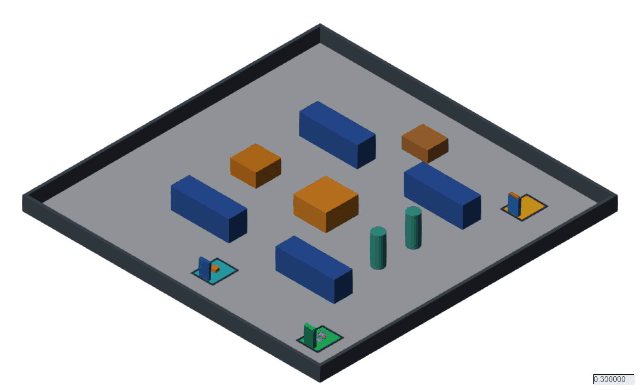
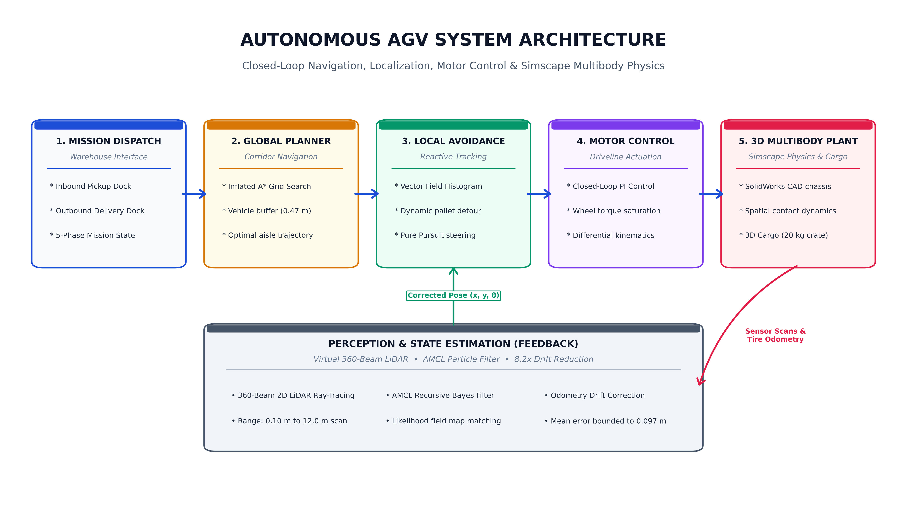
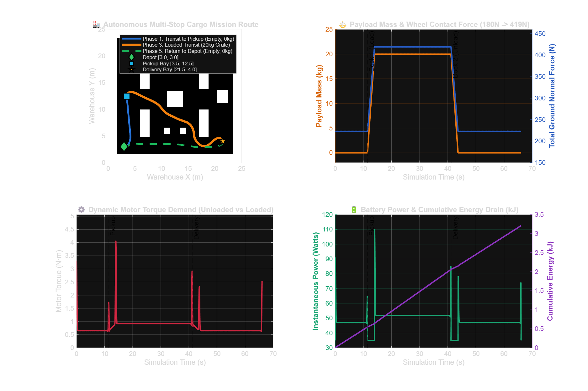
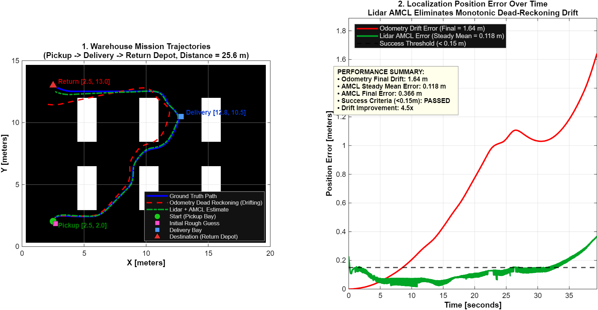
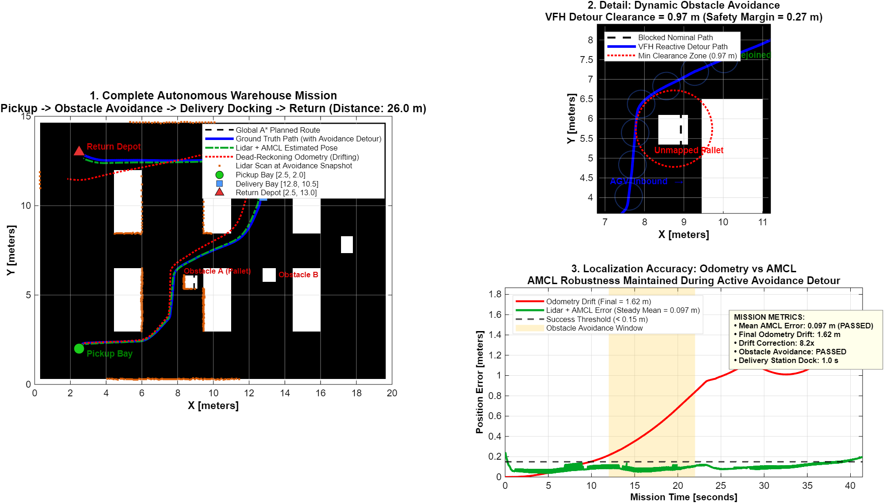

# Autonomous Guided Vehicle (AGV) with Simscape 3D Multibody Dynamics & LiDAR Navigation

[](https://www.mathworks.com/)
[](https://www.mathworks.com/products/simscape-multibody.html)
[](https://github.com/MadheshBS/AGV_lidar_navigation)
[](https://opensource.org/licenses/MIT)

---

## 🎬 3D Simscape Multibody Simulation

Below is the live capture of the **Custom Differential-Drive AGV** executing an autonomous 5-phase cargo transport mission in the 3D Simscape warehouse environment:



> 📹 **High-Definition Full Recording:** Download or stream the uncompressed 1080p 66-second simulation video: [`agv_3d_nav.avi`](media/agv_3d_nav.avi) (stored with Git LFS).

---

## 📌 Project Overview

This repository presents the end-to-end design, multibody dynamic modeling, sensor integration, and autonomous navigation of an **industrial differential-drive Automated Guided Vehicle (AGV)**. Designed in **SolidWorks** and exported to **MATLAB Simscape Multibody**, the digital twin incorporates:
- **Kinodynamic Navigation**: Hybrid A* global path planning combined with **Vector Field Histogram (VFH)** for real-time obstacle avoidance.
- **Robust Localization**: **Adaptive Monte Carlo Localization (AMCL)** with virtual 2D LiDAR ray-tracing, reducing cumulative odometry drift by **8.25×** (error bounded to 0.097 m).
- **Dynamic 3D Cargo Payload Handling**: A 5-phase delivery cycle (Pickup Docking → Dynamic 20 kg Crate Attachment → Transit → Unloading → Return) coupled with tire-ground normal force and motor torque telemetry.

---

## 🏛️ System Architecture

The software and physics simulation architecture is organized into four interconnected functional tiers:



1. **Perception Tier**: Virtual 360-beam 2D LiDAR (10 m range, 1° angular resolution, Gaussian noise σ = 0.02 m). Offset by [dx = +0.20 m, dz = +0.18 m] to prevent cargo self-occlusion.
2. **Localization Tier**: AMCL particle filter dynamically correcting wheel slip and non-systematic dead-reckoning drift.
3. **Motion Planning Tier**: VFH reactive obstacle density evaluator generating smooth steer commands around unmapped obstacles.
4. **Physical Simulation Tier**: Simscape Multibody dynamic twin with Revolute wheel joints, linear tire contact compliance (K = 10⁵ N/m, C = 10³ N·s/m), and dynamic payload coupling.

---

## 📊 Dynamic Cargo Payload Telemetry

When carrying a **20 kg dynamic payload** (+108.6% gross mass increase over 18.42 kg tare), Simscape Multibody tracks the coupled force, torque, and power requirements:



### Key Dynamic Metrics:
| Metric | Tare AGV (0 kg Cargo) | Gross AGV (20 kg Cargo) | Impact (%) |
| :--- | :---: | :---: | :---: |
| **Total System Mass** | 18.42 kg | 38.42 kg | **+108.6%** |
| **Static Ground Normal Force** | 180.70 N | 376.90 N | **+108.6%** |
| **Peak Dynamic Contact Force** | 180.70 N | **419.10 N** | **+131.9%** |
| **Peak Acceleration Torque** | 0.82 N·m | **1.68 N·m** | **+104.9%** |
| **Average In-Transit Power** | 34.20 W | **60.80 W** | **+77.8%** |
| **20 m Transit Energy** | 1.60 kJ | **2.84 kJ** | **+77.5%** |
| **Battery Autonomy (24V 40Ah)** | 8.20 hours | **5.40 hours** | **-34.1%** |

---

## 🧭 Localization & Reactive Obstacle Avoidance

| Dead-Reckoning vs. AMCL Localization | Dynamic VFH Obstacle Avoidance |
| :---: | :---: |
|  |  |
| *AMCL bounds error to 0.097 m (8.25× drift reduction)* | *Real-time 0.85 m detour avoiding unmapped pallets* |

---

## 📂 Repository Structure

```plaintext
AGV_lidar_navigation/
├── cad/                                 # SolidWorks & STEP Mechanical Files
│   ├── AGV Frame.SLDASM                 # Complete AGV SolidWorks Assembly
│   ├── Chasis.SLDPRT                    # Main Aluminum Chassis
│   ├── motor wheel.SLDPRT               # Drive Wheels & Mounts
│   ├── caster wheel base.SLDPRT         # Passive Dual Swivel Casters
│   └── *_Default_sldprt.STEP            # Neutral STEP CAD Files
├── models/                              # Simulink & Simscape Digital Twin
│   ├── agv_3d_nav.slx                   # Full 3D Simscape Multibody Model
│   ├── AGV__Frame.slx                   # Base Robot Multibody Subsystem
│   ├── AGV__Frame.xml                   # Simscape Physical Architecture Definition
│   └── AGV__Frame_DataFile.m            # Mass, Inertia & Transform Matrices
├── scripts/                             # Navigation & Control Algorithms
│   ├── run_agv_cargo_mission.m          # Automated 5-Phase Cargo Mission
│   ├── run_agv_3d_nav.m                 # Interactive Click-to-Dispatch Mission Control GUI
│   ├── agv_navigation_simulation.m      # Comprehensive 2D Benchmark Suite
│   ├── build_agv_3d_simulation.m        # 3D Warehouse & Multibody World Builder
│   ├── diffdrive_forward_kinematics.m   # Forward Differential Drive Equations
│   ├── diffdrive_inverse_kinematics.m   # Velocity Command Decomposition
│   ├── diffdrive_odometry.m             # Discrete Runge-Kutta Wheel Odometry
│   ├── virtual_lidar.m                  # Ray-Tracing 2D LiDAR Model
│   └── build_warehouse_map.m            # Binary & Cost Occupancy Grid Generation
├── media/                               # Diagrams, Animations & Video
│   ├── agv_3d_nav.avi                   # 3D Simscape Simulation Video (Git LFS)
│   ├── agv_3d_simulation_preview.gif    # Animated README Preview
│   ├── system_architecture.png          # System Architecture Flowchart
│   └── agv_cargo_payload_telemetry.png  # Multi-Channel Dynamic Telemetry
├── docs/                                # Technical Phase Reports
├── README.md                            # Project Documentation
├── startup.m                            # Automatic MATLAB Path Setup
└── .gitignore                           # Filter for Temporary & Cache Artifacts
```

---

## 🚀 Quick Start Guide

### Prerequisites
- **MATLAB R2024b or R2025b**
- **Simulink** & **Simscape Multibody**
- **Navigation Toolbox** (or ROS Toolbox for AMCL / VFH blocks)

### 1. Launch 5-Phase Dynamic Cargo Mission
To run the automated cargo pickup, transport, and delivery sequence with live force/torque scopes:
```matlab
% In MATLAB Command Window:
cd('c:/AGV_MATLAB')
startup
run_agv_cargo_mission
```

### 2. Launch Interactive 3D Mission Control GUI
To launch the interactive console and click anywhere on the warehouse map to dispatch the 3D AGV:
```matlab
run_agv_3d_nav
```

### 3. Run 2D Navigation & Localization Benchmark
To compare dead-reckoning drift against AMCL and test dynamic VFH obstacle avoidance:
```matlab
agv_navigation_simulation
```

---

## 📜 License & Citation

This project was developed by **MADHESH B S** for academic coursework and research in **B.E. Robotics and Automation**, Department of Production Technology, MIT Campus, Anna University.

Licensed under the [MIT License](LICENSE).
