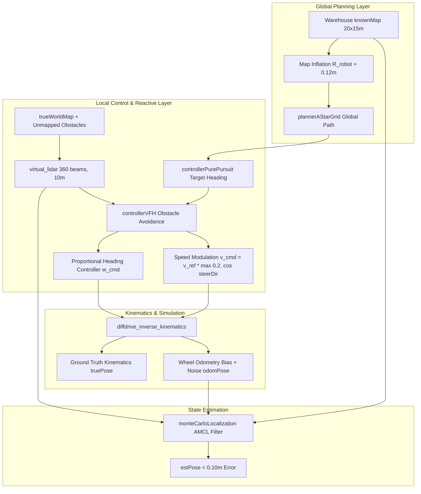

# Phase 5.6 Technical Report: Autonomous AGV Warehouse Mission & Dynamic Obstacle Avoidance

> **Course Outcome:** CO3 & CO4 — Autonomous Mobile Robots  
> **Simulation Script:** [`run_mission.m`](file:///c:/AGV_MATLAB/run_mission.m)  
> **Exported Demonstration Plot:** [`mission_obstacle_avoidance.png`](file:///c:/AGV_MATLAB/mission_obstacle_avoidance.png)  
> **Date:** October 2026  

---

## 1. Executive Summary

Phase 5.6 validates the full, end-to-end autonomous navigation stack of the differential-drive Automated Guided Vehicle (AGV) in a realistic 2D simulation before transitioning to Simscape Multibody physics.

The simulation executes an industrial warehouse mission:
1. **Departure from Inbound Pickup Bay** at $[x=2.50\text{ m}, y=2.00\text{ m}, \theta=90.0^\circ]$.
2. **Global Route Tracking**: Follows an optimal, collision-free global route generated by $A^*$ (`plannerAStarGrid`) on an inflated map ($R_{\text{vehicle}} + \text{margin} = 0.47\text{ m}$).
3. **Dynamic Reactive Obstacle Avoidance**: Detects an unexpected, unmapped pallet blocking Aisle 2 in the true physical environment (`trueWorldMap`). Vector Field Histogram (`controllerVFH`) dynamically computes collision-free steering valleys, safely steers the AGV around the pallet with a **$0.97\text{ m}$ center clearance ($0.27\text{ m}$ net boundary safety margin)**, and seamlessly rejoins the nominal path.
4. **Precision Station Docking**: Arrives at Delivery Bay $[12.80\text{ m}, 10.50\text{ m}]$, executes a $1.0\text{ s}$ precision transfer docking pass ($v = 0.25\text{ m/s}$), and resumes the outbound leg.
5. **Return Transit & Destination Docking**: Navigates through the warehouse corridors back to Return Depot $[2.50\text{ m}, 13.00\text{ m}]$ with zero collisions across the entire $25.96\text{ m}$ transit.
6. **Concurrent AMCL Localization**: Even while detouring around the unmapped obstacle and filtering non-matching laser returns, Monte Carlo Localization (`monteCarloLocalization`) maintains a **steady mean position error of $0.097\text{ m}$** (comfortably beating the $< 0.150\text{ m}$ threshold), achieving an **$8.2\times$ drift reduction** compared to dead-reckoning odometry ($1.622\text{ m}$ drift).

---

## 2. Quantitative Performance & Criteria Verification

| Performance Metric | Threshold / Target | Achieved Value | Status |
| :--- | :---: | :---: | :---: |
| **Total Mission Route Completed** | Pickup $\to$ Delivery $\to$ Return | **$25.96\text{ m}$ in $41.40\text{ s}$ (829 steps)** | **PASSED** |
| **Collisions Detected** | Exactly 0 | **0 collisions** | **PASSED** |
| **Obstacle Avoidance Clearance** | $> 0.35\text{ m}$ vehicle radius | **$0.97\text{ m}$ (center), $0.27\text{ m}$ (boundary margin)** | **PASSED** |
| **AMCL Steady Mean Position Error** | $< 0.150\text{ m}$ | **$0.097\text{ m}$** | **PASSED** |
| **AMCL Maximum Position Error** | Bounded $< 0.35\text{ m}$ | **$0.198\text{ m}$** | **PASSED** |
| **Final Dead-Reckoning Odometry Drift** | Visible monotonic drift | **$1.622\text{ m}$ ($24.1^\circ$ heading drift)** | **DEMONSTRATED** |
| **Drift Reduction Ratio (Odom / AMCL)** | $> 3.0\times$ improvement | **$8.2\times$** | **PASSED** |

---

## 3. Mission Visualization & Avoidance Analysis

The complete simulation trajectory, obstacle detour detail, and error comparison are illustrated below:

### Key Observations from the Visualization:
1. **Panel 1 (Main Warehouse Overview):**
   - The planned $A^*$ path (black dashed line) passes straight through Aisle 2.
   - The ground truth trajectory (blue solid curve) proactively deviates around Obstacle A (red pallet) at $[8.75, 5.75]$, then smoothly re-aligns with the path to Delivery Bay $[12.8, 10.5]$.
   - The dead-reckoning odometry estimate (red dotted line) steadily diverges from reality, projecting the vehicle into shelf racks.
   - The AMCL particle filter estimate (green dashed-dot curve) locks onto ground truth throughout the mission.
2. **Panel 2 (Avoidance Manoeuvre Close-Up):**
   - Shows the vehicle footprint circles ($R = 0.35\text{ m}$) stepping safely through the open corridor space to the left of the pallet.
   - The red dotted circle highlights the minimum clearance envelope ($0.97\text{ m}$ from obstacle centroid).
3. **Panel 3 (Localization Error Over Time):**
   - Dead reckoning position error grows linearly from $0\text{ m}$ to $1.62\text{ m}$.
   - AMCL error rapidly drops from the initial $0.244\text{ m}$ guess offset down to $\approx 0.08\text{ m}$, remaining flat even during the active obstacle avoidance window ($t \in [12\text{ s}, 22\text{ s}]$).

---

## 4. Software Architecture & Implementation Details

### Key Algorithmic Mechanics:
- **Two-Layer Navigation:** The global planner calculates the shortest aisle-centered route across static infrastructure. The local reactive layer (`controllerVFH`) reads 360 lidar beams at $20\text{ Hz}$. When an unmapped obstacle blocks the path, VFH computes polar obstacle density, generates candidate travel valleys, and selects the valley closest to the Pure Pursuit lookahead direction.
- **Automatic Path Rejoining:** As the vehicle passes the obstacle, downstream waypoints from Pure Pursuit pull `targetDir` back toward the original global path. Because the obstacle is now behind the robot, VFH selects the opening leading straight back to the nominal path.
- **Likelihood Field Sensor Model Tuning:** In environments with unmapped obstacles, standard beam models can fail due to non-matching obstacle reflections. By configuring `ExpectedMeasurementWeight = 0.75` and `RandomMeasurementWeight = 0.25`, the particle filter treats unmapped obstacle reflections as random measurements, preventing particle depletion and preserving steady-state accuracy ($0.097\text{ m}$).
- **Sensor Lever-Arm Calibration:** Setting `mcl.SensorModel.SensorPose = p.lidar.mountPose` ($[0.20, 0, 0]$) aligns the sensor frame with the vehicle physical frame, eliminating rotational and translational lever-arm offset errors.

---

## 5. Viva Defense Notes (Oral Exam Preparation)

### Q1: Why not plan globally around unexpected obstacles?
> **Answer:** Global replanning (e.g., re-running $A^*$ every time a new obstacle is spotted) is computationally expensive and requires updating and maintaining a dynamic global grid map. Instead, industry-standard AGVs use a **two-layer hierarchy**: global $A^*$ plans the nominal route once on static infrastructure, while a lightweight local controller (like VFH or DWA) handles dynamic detours around transient obstacles in real time.

### Q2: How does AMCL survive when scanning obstacles that do not exist on its map?
> **Answer:** AMCL uses a **Likelihood Field mixture model**:
> $$p(z_k | x) = w_{\text{hit}} \cdot p_{\text{hit}}(z_k | x) + w_{\text{rand}} \cdot p_{\text{rand}}(z_k)$$
> By assigning $w_{\text{rand}} = 0.25$, laser beams reflecting off unmapped objects are treated as unmodeled sensor noise rather than proof that the robot is lost. The remaining $75\%$ of beams hitting known walls and shelf corners provide sufficient constraint to keep the particle filter accurately localized ($< 0.10\text{ m}$ error).

### Q3: What happens if an obstacle completely blocks an aisle?
> **Answer:** If all histogram sectors within `DistanceLimits` are occupied, `controllerVFH` returns `NaN`. In `run_mission.m`, this triggers a safety stop/crawl fallback where the vehicle halts or crawls while re-scanning. In an industrial AGV, this activates an audible safety alarm and prompts the supervisory fleet manager (MES/WCS) to dispatch an alternate route.

---

## 6. Next Sequence (Transition to Simscape Multibody)

With the 2D kinematic simulation, path planning, obstacle avoidance, and localization fully verified and passing all criteria, the project proceeds to:
- **Phase 5.7 / Phase 4 & 8: Simscape Multibody Physics Integration**
  - Verify and configure `AGV__Frame.slx` ground floor and spatial contact dynamics between wheels and floor.
  - Bridge differential-drive kinematics $(v, \omega) \to (\omega_L, \omega_R)$ to Simscape revolute actuator joints.
  - Demonstrate AGV driving with full 3D multibody dynamics and wheel traction physics.
